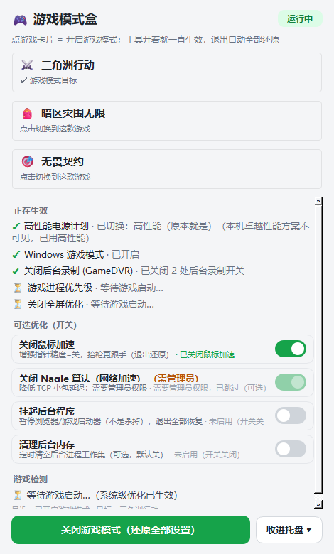

# 🎮 游戏模式盒 GameModeBox

> ⚠️ **许可证：PolyForm Noncommercial 1.0.0 —— 允许自用、允许改着玩，但禁止任何形式的商用。**
> Required Notice: Copyright zzkuamu 2026 https://github.com/zzkuamu/GameModeBox

给 **三角洲行动 / 暗区突围无限 / 无畏契约** 做的 Windows 游戏模式开关：
双击打开 → 选游戏 → 进入游戏模式；**工具开着就一直生效，关闭工具（或点 ✕）= 关闭游戏模式并把所有修改逐项还原**。



## 用法

| 操作 | 效果 |
|---|---|
| 双击 `启动游戏模式.cmd`（或桌面「游戏模式盒」快捷方式 / `main.pyw`） | 打开工具；上次玩过哪款就自动进入那款的游戏模式 |
| 点游戏卡片 | 选择目标游戏并开启游戏模式（可随时切换） |
| 标题栏「—」 | 收进右下角任务栏（托盘），**游戏模式保持开启** |
| 标题栏「✕」/ 托盘「退出」 | **关闭游戏模式 → 全部还原 → 退出** |
| 大按钮「关闭游戏模式」 | 还原全部设置，但工具保持打开 |
| 双击 `启动游戏模式(管理员).cmd` | 以管理员运行，可选的网络加速（Nagle）才会生效 |

依赖：Windows 10/11 + Python 3.10+（需带 PySide6）。

## 优化项（每一项都「先记原值 → 再修改 → 回读验证 → 退出精确还原」）

| 优化项 | 作用 | 默认 | 需管理员 | 退出还原 |
|---|---|---|---|---|
| 高性能电源计划 | 卓越性能 → 高性能（自动探测+降级） | 开 | 否 | ✅ 切回原计划 |
| Windows 游戏模式 | `AllowAutoGameMode=1`，抑制后台活动 | 开 | 否 | ✅ 原值回写 |
| 关闭后台录制 (GameDVR) | 停用 Game Bar 后台捕获 ×2 处 | 开 | 否 | ✅ 原值回写 |
| 关闭鼠标加速 | 抬枪更跟手 | 开 | 否 | ✅ 原值回写 |
| 关闭 Nagle 算法 | 降低 TCP 小包延迟 | 开 | **是** | ✅ 原值回写 |
| 游戏进程优先级 → 高 | 检测到游戏进程后自动提权 | 开 | 否 | ✅ 恢复原优先级 |
| 关闭全屏优化 | 对检测到的游戏 exe 写兼容性标志 | 检测到后 | 否 | ✅ 精确还原（含保留你原有标志） |
| 挂起后台程序 | 暂停浏览器/启动器（不是杀掉） | 关 | 否 | ✅ 恢复进程 |
| 清理后台内存 | 30 秒清一次后台工作集 | 关 | 否 | 无需（自动回填） |

设计纪律：

- **先记账再动手**：所有原值写入 `state.json`（原子写）。关闭 = 按账本逐项精确还原（不是"删掉了事"）。
- **崩溃自愈**：进程被强杀没来得及还原 → 下次启动自动按账本还原残留。
- **失败要出声**：每项在界面上显示真实回读结果；非管理员时 Nagle 显示灰色「需要管理员权限，已跳过」，绝不假成功。
- **不假死**：powercfg 在 pythonw 下单次可达秒级（实测首调 5.7s），应用/还原都在后台线程跑，UI 全程可响应（`IsHungAppWindow` 实测为 False）。

## 游戏识别（双通道）

| 游戏 | 进程名通道 | 窗口标题通道（兜底） |
|---|---|---|
| 三角洲行动 | `DeltaForce.exe` | 「三角洲行动」「Delta Force」 |
| 暗区突围无限 | `UAGame.exe` / `ABInfinite.exe` 等 | 「暗区突围」「Arena Breakout」 |
| 无畏契约 | `VALORANT-Win64-Shipping.exe` | 「VALORANT」「无畏契约」 |

窗口标题通道保证即使 exe 名对不上也能认出游戏；启动器/反作弊进程（Riot Client 等）绝不提权。

## 测试（四套，141 项断言，全部真跑过）

```text
python main.pyw --selftest          # 69 项：优化项应用/还原 + 负向测试
python main.pyw --gui-test          # 45 项：结构 + 真实点击 + 像素级截图断言
python main.pyw --e2e               # 12 项：子进程真实启动 → WM_CLOSE → 验证还原
python tools/verify_launcher.py     # 15 项：双击链路（.cmd → 关联 → 开模式 → 关闭还原）
```

测试纪律（照做不打折）：

- **断言一律独立回读**：测试自己用 winreg/powercfg 直读系统，不采信被测函数的返回值。
- **负向测试**：注入「说谎的优化项」（自报成功但什么都没改），检查器必须报红；注入后仍全绿的检查器不算数。
- **系统状态安全网**：测试无论成败，收尾无条件还原电源计划/注册表，并把「还原干净没有」本身写成断言。

## 已知限制

- 开启/还原过程中，状态胶囊显示「开启中… / 还原中…」，整个流程在弱机上可能要几秒（受 `powercfg` 自身延迟影响），但窗口不假死。
- 非管理员运行时 Nagle 不可用（用带 (管理员) 的启动脚本）。
- 「卓越性能」电源计划在部分机器被系统拒绝激活（rc=1），会自动降级为「高性能」。

## 参考与致谢

- [OpenGameBoost](https://github.com/bensheed/OpenGameBoost)（MIT）：电源计划 GUID、Nagle 注册表键位、VALORANT 进程名（其标注 Verified）等参考。本项目在还原策略上不同：**按记录的原值精确回写**，而不是直接删除键值。
- 识别与验证方法学来自本机技能 `pyside6-desktop-ui-polish`、`windows-desktop-icon-and-input-tooling`、`publish-local-project-to-github`（负向测试、像素断言、独立回读、隐私闸门）。

## 项目结构

```text
main.pyw               入口（双击即跑；--selftest/--gui-test/--e2e/--smoke）
gmb/
  app.py               界面 + 托盘 + 异步状态机（开启/还原在后台线程）
  tweaks.py            9 个优化项：记账→改→回读→还原 + 崩溃自愈
  winapi.py            ctypes 薄封装（进程/优先级/挂起/工作集/窗口）
  detect.py games.py   游戏检测双通道与三款游戏档案
selftest.py            逻辑自检（含负向）
test_gui.py            界面行为自检（含像素断言）
test_e2e.py            端到端自检
tools/
  verify_launcher.py   双击链路验证
  make_desktop_shortcut.py  桌面快捷方式（ctypes 走 Shell COM）
  make_icon.py gen_launchers.py  图标/启动脚本生成器
启动游戏模式.cmd         双击入口（纯 ASCII + CRLF）
启动游戏模式(管理员).cmd  管理员入口（为 Nagle）
docs/                  截图
```

## License

**PolyForm Noncommercial 1.0.0**（全文见 [LICENSE](LICENSE)）：自用和二次开发自由，**禁止商用**。

> 注：GitHub 侧栏不会识别这份许可证（会显示 Other），这是平台限制，以本文件为准。
> Required Notice: Copyright zzkuamu 2026 https://github.com/zzkuamu/GameModeBox
